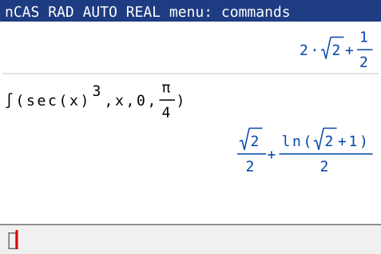
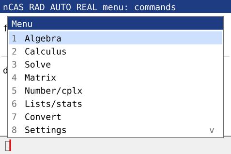
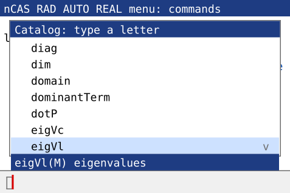

# nCAS: a computer algebra system for the TI-Nspire CX II (non-CAS)

nCAS is a pure-Python CAS that runs in the CX II's built-in Python (MicroPython,
OS 5.2 or later). It adds the symbolic commands that the CX II CAS / CX II-T CAS
has and the plain CX II lacks: exact arithmetic, `solve`, `factor`, `expand`,
derivatives, integrals, limits, series, `deSolve`, symbolic matrices, and more.
Command names and syntax follow the TI-Nspire CAS Reference Guide.



```
> solve(x^2-5x+6=0,x)
x=2 or x=3
> integral(x*e^(2x),x)
x*e^(2*x)/2-e^(2*x)/4
> deSolve(y''+y=0 and y(0)=1 and y'(0)=0,x,y)
y=cos(x)
> factor(x^4-16)
(x-2)*(x+2)*(x^2+4)
> limit((1+1/n)^n,n,inf)
e
```

## Files

| Folder | Contents |
|---|---|
| `onefile/ncastext.py` | **Text version**: one file (~236 KB), program name `ncastext`. Commands at a `>` prompt, plus the text menus. |
| `onefile/ncasx.py` | **Exact calculator**: one small file (~57 KB), program name `ncasx`. Type an expression, get the exact value and its decimal value. No menus. |
| `onefile/ncasgui.py` | **Full-screen version**: one file (~267 KB), program name `ncasgui`. Needs `ti_draw` and `ti_system.get_key`. |
| `dist/` | The module install: 12 modules plus the `ncas` launcher (`casx.py` is only for ncasx and is not needed). |
| `src/` | Readable source, the same program. |
| `tests/` | Regression, edge-case, menu, fuzz and property tests (run on a computer). |
| `tools/build.py`, `tools/onefile.py` | Rebuild `dist/` and `onefile/` from `src/`. |
| `tools/paste_parts.py` | Copies a program to the clipboard in parts, for the TI editor. |
| `tools/shots.py` | Draws the pictures in `docs/img/` (simulated screens). |

| Module | Role |
|---|---|
| `cascore` | exact numbers, expression simplifier, trig/log rules |
| `casout` | output formatting |
| `casparse` | input parser (TI syntax) |
| `caspoly` | polynomial GCD, factoring, partial fractions, `comDenom` |
| `cascalc` | derivatives, integrals, limits, series, Σ/Π, `tExpand`/`tCollect` |
| `cassolve` | `solve`, inequalities, systems, `deSolve`, `fMin`/`fMax`, `domain` |
| `casmat` | matrices, vectors, list statistics |
| `casfun` | built-in function table, conversions (►) |
| `cashelp` | on-calculator help and self-test (loaded only when used) |
| `casmenu` | menu mode (loaded only when used) |
| `casgui` | full-screen mode (loaded only when used) |
| `cas` | evaluator and command loop |
| `ncas` | launcher: starts nCAS; if a module is missing or has the wrong contents, it says which one |

## Installing on the calculator (single file, recommended)

**Easiest:** download the ready `.tns` documents from the
[latest release](https://github.com/truthadmire/ncas-for-ti-nspire/releases/latest),
send them to the handheld with the TI-Nspire computer software, open one and run
it with **Ctrl+R**. The steps below build the documents yourself.

There are three separate programs; install either or both, each in its own
document. You need TI-Nspire CX Student/Teacher Software and handheld OS 5.2+, in
normal mode (not Press-to-Test).

| Program | File | Starts |
|---|---|---|
| `ncastext` | `onefile/ncastext.py` | the text mode (`>` prompt) |
| `ncasgui` | `onefile/ncasgui.py` | the full-screen mode |
| `ncasx` | `onefile/ncasx.py` | the exact calculator (see below) |

1. In the TI-Nspire computer software: **File ▸ New TI-Nspire Document**, then
   **Insert ▸ Python ▸ New…**, name the program (`ncastext` or `ncasgui`) and
   choose a blank program.
2. The editor refuses a paste this large ("data too large to paste"), so copy the
   file in parts: in Terminal, run for example
   `python3 tools/paste_parts.py onefile/ncastext.py 20000`, paste each part at the
   end of the program and press Enter in Terminal for the next one (12 parts for
   ncastext, 14 for ncasgui). It prints the line count the editor should show
   after each part. On Windows and Linux it uses `clip`, `wl-copy`, `xclip` or
   `xsel`; without any of them it writes each part to a file to copy from. (The editor adds an empty
   line after each paste below the cursor; that is harmless.) Then use
   **Check Syntax & Save** (cmd+B).
3. Save the document (`ncastext.tns` / `ncasgui.tns`) and send it to the
   handheld. Keep it in My Documents; it is not a module.
4. Open it and run it with **Ctrl+R**. It prints `Loading nCAS...`, then starts.

**Leaving and stopping.** In the text version type `q` and enter (after two
empty lines it reminds you). In the full-screen version press esc on an empty
line. A long calculation can be stopped with the calculator's break key
(**home/on**). Exact results that would be huge, such as `2^(10^9)`, stay
unevaluated, because big-number arithmetic cannot be interrupted and would
freeze the calculator; `mod(2^(10^9),7)` still works.

**How it keeps memory low.** MicroPython compiles a whole program at once, and
compiling 250 KB of code needs more memory than the program itself. So
each file keeps the program as about 50 text parts (with common words shortened to
2-character codes) and compiles them one at a time with `exec()`. Help and the
menus are compiled only when you first use them. Measured on a 64-bit computer
(the calculator is 32-bit, so its numbers should be smaller):

| | Memory in use after loading | Smallest heap that passes `:test` |
|---|---|---|
| `onefile/ncastext.py` / `ncasgui.py` | about 550 KB (about 350 KB after a restart, see below) | 0.7 MB / 0.9 MB |
| module install (`dist/`) | 310 KB | 0.6 MB |

The calculator has about 2 MB. Type `:mem` to see free memory. If you run short,
leave nCAS, then type `cas()` (ncastext) or `gui()` (ncasgui) in the Shell: the stored text is freed once the program has
ended, which gives back about 190 KB.

### Module install (alternative)

For each of the 12 module files in `dist/` (`cascore.py`, `casout.py`, `casparse.py`,
`caspoly.py`, `cascalc.py`, `cassolve.py`, `casmat.py`, `casfun.py`, `cashelp.py`,
`casmenu.py`, `casgui.py`, `cas.py`; `casgui` is needed only for the full-screen mode):

1. Make a new document with a Python program named exactly like the file (for
   example `cascore`), paste the file, and use **Check Syntax & Save**.
2. Save the document with the same name (for example `cascore.tns`), send it to
   the handheld, open it and choose **Menu ▸ Actions ▸ Install as Python Module**.
   The file moves to the `PyLib` folder. The module name is the `.tns` file name.

Then make a document with a program named `ncas` holding `dist/ncas.py` (the
launcher, 28 lines), keep it in My Documents and run it with **Ctrl+R**.
`cas.tns` must hold `dist/cas.py` (about 1060 lines, starting `from cascore import*`),
not the launcher. If nCAS can't start, the launcher lists each module as `ok`,
`MISSING` or `WRONG CONTENTS`. `cashelp`, `casmenu` and `casgui` are loaded only
when you open help, the menu or the full-screen mode; without `casgui` the
launcher starts the text mode.

### Check the installation

At the `>` prompt, type `:test`. You should see `18/18 tests passed`.

If the launcher says every module is `MISSING`, check for Press-to-Test: a lock icon
in the title bar and a blinking LED. Press-to-Test hides everything that was on the
calculator before it started, and deletes everything added during it when it ends.
Exit Press-to-Test, then install the modules in normal mode.

## Exact calculator (`ncasx`)

A separate, small program for exact arithmetic: no menus, no modes to set up.
It loads about three times faster than the full program and runs in about
400 KB of memory. Install it like the others (program name `ncasx`, 3 paste
parts with `tools/paste_parts.py onefile/ncasx.py 20000`).

```
> 1/3+1/6               1/2  ≈ 0.5
> sqrt(8)               2*√2  ≈ 2.828427125
> sin(pi/3)             √3/2  ≈ 0.8660254038
> 1/(1+sqrt(2))         √2-1  ≈ 0.4142135624
> factor(360)           2^3*3^2*5
> f(x):=x^2+1           Done
> f(3)                  10
```

- Each result shows the exact value and, when it differs, the decimal value.
- Functions: sqrt, root(x,n), sin…arctan (+ hyperbolic), ln, log(x) (= ln),
  log(x,b), log10, e^x/exp, abs, floor, ceiling, n!, nCr, nPr, gcd, lcm, mod,
  factor (integers and fractions), expand, approx, exact, real, imag, conj, angle.
- `a:=5` or `5->a` stores, `f(x):=…` defines a function, `ans` is the last result,
  `expr|x=3` substitutes.
- `deg` / `rad` switch the angle unit (the prompt shows `deg>`), `digits 6`
  sets the decimals, `clear` forgets variables, `q` quits.
- Solving, calculus and matrices are in `ncastext` / `ncasgui`.

## Full-screen mode (on the calculator)

On the calculator nCAS starts in a full-screen mode modelled on the CAS
Calculator app. The status bar shows the angle unit, the mode and real/complex.

| Key | Action |
|---|---|
| typing, **enter** | type on the entry line at the bottom; enter evaluates |
| **◄ ►**, **del**, **clear** | move the cursor, delete to the left, clear the line |
| **▲ ▼** | select an earlier input or result; **enter** copies it to the entry line. A result taller than the screen scrolls line by line before the selection moves on |
| **menu** | command menus: arrows + enter, or the number/letter shown (**ctrl tab** too) |
| **tab** / **shift tab** | next / previous field: template slots and command arguments after commas (`integral(\|,x,,)`) |
| **catalog** | every command A–Z with its syntax under the list; type a letter to jump, enter puts `name()` on the line |
| **trig** | sin, cos, tan, arcsin, … |
| **ctrl** + key | the blue keypad functions: ( → `[ ]`, ) → `{ }`, ^ → root, x² → √, e^x → ln, 10^x → log10, = → ≠ ≤ ≥ list, (−) → ans, × → " ", ÷ → fraction, var → `->`, enter → ≈ decimal, del → clear, esc → undo, catalog → Symbols, trig → help. **doc** works as ctrl too. |
| **menu ▸ 9 Templates** | matrix m×n, column and row vector grids (enter inserts `[1,2;3,4]`); fraction, power, square root, n-th root, \|x\| and e^x templates |
| **2D entry** | ctrl ÷ = fraction, ^ = exponent, x² = square, ctrl x² = √, ctrl ^ = n-th root; ◄► move through slots, ▲▼ between numerator and denominator; typing + − × ÷ = < > , ) at the end of an exponent leaves it. Sent to nCAS as text: `3/(x+1)`. |
| **2D results** | inputs (left) and results (right) in the history are drawn in 2D: stacked fractions, raised powers, √ and n-th roots, matrices as grids, lists, ≠ ≤ ≥. Messages, DMS, polar form and results too wide for the screen stay as text. |
| **menu ▸ a Symbols** | a page of 40 symbols that cannot be typed while a program runs (`; [ ] { } \| ' ≠ ≤ ≥ := → √ π ∞ ° >>` …); arrows + enter |
| **esc** | leave the selection, clear the line, or (on an empty line) quit |

- A menu command is put on the entry line with the cursor where the first value
  goes: Calculus ▸ Derivative gives `d(|,x)`, Matrix ▸ det gives `det([|])`.
  Settings items (Degree, Self-test, Memory, …) run at once.
- While you type a command's arguments, the status bar shows its syntax, for
  example `integral(expr,var) antiderivative`.
- An operator typed on an empty line starts with `ans`, as on the CAS.
- Results are blue, errors red. The last 30 entries are kept.
- After quitting, type `gui()` in the Shell to come back, or `cas()` for the
  text mode. In the text mode, `g` opens the full-screen mode.

 
- A key nCAS does not use is named in the status bar. **Settings ▸ Key test**
  shows the name of every key you press; send those names if a key does not do
  what you expect.
- **Older OS versions.** The full-screen mode looks for the key function
  (`ti_system.get_key`, or a similar name in `ti_system`, `ti_draw` or
  `ti_plotlib`; waiting or polled) and adapts `ti_draw` calls (no buffer, no
  screen-size query, colour as one tuple). If the OS gives programs no way to read
  single keys, `ncasgui` opens a compact **screen mode** in the Shell instead:
  type and press enter, `m` for the menus, `#2` for result 2 (`factor(#2)`),
  `q` to quit. Its first line lists what the calculator's `ti_system` contains.
- **Key bridge through TI-Basic (experimental).** If Python has no key function
  but `ti_system` has `eval_function`, nCAS can read keys through TI-Basic's own
  `getKey()`. In the `ncasgui` document, in the same problem, create the
  TI-Basic function `ncaskey` with **Add Program Editor ▸ New…** (type Function);
  the text and two quick tests are in `onefile/ncaskey.txt`. Then run `ncasgui`;
  it uses the bridge automatically. Not yet
  tried on a calculator: TI-Basic may not deliver keys while Python runs.
- This mode was built from TI's documentation and tested with a simulated screen
  and keypad; the layout values (row height, character width) are at the top of
  `src/casgui.py`.

## Menu mode (text mode, no command names to type)

At the `>` prompt, type `m` and press **enter** (or call `menu()` from the Python
Shell). Pick items by number or letter, answer the questions, and nCAS builds the
TI command, shows it, and runs it. Press **enter** on a question to accept the
default shown in `[brackets]`. Type `0` to go back and `q` to leave the menus.

```
-- nCAS menu --
1 Algebra       2 Calculus
3 Solve         4 Matrix
5 Number/cplx   6 Lists/stats
7 Convert       8 Settings
#: 2
-- Calculus --
1 Derivative    2 Deriv at pt
3 Integral      4 Def integral
5 Limit         6 Taylor  ...
#: 4
f: e^(-x)
Var [x]:
Lower (inf ok): 0
Upper: inf
> integral(e^(-x),x,0,inf)
1
```

- Matrices can be typed as `1,2;3,4` (rows separated by `;`).
- Answers can use `ans` (the last result) and anything you have defined.
- The menus cover 99 commands: algebra, calculus, solving and systems,
  `deSolve` with conditions, matrices, numbers and complex numbers, lists and
  statistics, conversions, and settings (including defining functions and the
  self-test).

## Using nCAS

Type a command at the `>` prompt and press **enter**. Type `m` for menus, `?` for help and `q` to quit.

| You type | Meaning |
|---|---|
| `2x`, `3(x+1)`, `x(x+1)` | implicit multiplication |
| `^` or `**` | power (the [^] key types `**`, which works) |
| `sqrt(x)` or `√x`, `root(x,3)` | roots |
| `pi`, `e`, `i`, `inf` | π, Euler's e, imaginary unit, ∞ (`e` and `i` are reserved) |
| `ln(x)` or `log(x)` | **natural log.** The [ln] key types `log(`, so `log(x)` = ln x |
| `log10(x)`, `log(x,b)` | base-10 and base-b logs |
| `=  /=  <  >  <=  >=  and  or  not` | relations and logic (`==` and `!=` also work) |
| `expr|x=3`, `expr|x>0` | the "with" operator: substitute or constrain |
| `f(x):=x^2` or `Define f(x)=x^2` | define a function |
| `5->a` or `a:=5` | store a variable; `delvar a` deletes it |
| `expr>>Decimal` | conversion operator ► (also `@>`) |
| `ans` | last result |
| `{1,2,3}` | list |
| `[[1,2][3,4]]` or `[1,2;3,4]` | matrix |
| `1.5E3` | scientific notation |
| `y'`, `y''` | derivatives inside `deSolve` |

Results are exact unless the input contains a decimal, as in the CAS's Auto mode.
`approx(expr)` or `expr>>Decimal` gives a decimal.

**Kept between runs.** Settings (angle, mode, digits, …), variables and
functions are saved in the document, in the list variable `ncasmem`, after each
change, and come back the next time the program runs (also after reopening the
document, if it was saved). `:clear` and `delvar` remove them there too. The
text prompt shows modes that differ from the defaults, for example `deg approx> `.

**Errors.** A command with the wrong number of arguments shows its syntax
(`Wrong number of arguments for integral` / `integral(expr,var) antiderivative`).
A name one letter away from a command gets a hint: `factr(x^2-1)` is shown
unevaluated, with `(factr is not a command; did you mean factor?)`. `diff`,
`deriv`, `integrate`, `avg` and `cbrt` are accepted as other names for `d`,
`integral`, `mean` and `root(x,3)`.

### Settings and commands

| Command | Effect |
|---|---|
| `:deg` `:rad` `:grad` | angle mode |
| `:auto` `:exact` `:approx` | Auto/Exact/Approximate mode |
| `:real` `:complex` | Real mode gives "Non-real result" errors; complex mode allows them |
| `:digits n` | significant digits shown for decimals (1–15) |
| `:ascii` `:unicode` | `sqrt( pi inf` or `√ π ∞` in output |
| `:vars`, `:clear`, `delvar a` | list, clear and delete variables and functions |
| `:mode` | show the current settings |
| `:mem` | show free and used memory |
| `?`, `?topic`, `?command` | help, for example `?calc` or `?solve` |
| `m` | menu mode |
| `:test` | run the self-test |

### Command reference (TI names, case-insensitive)

**Algebra:** `solve`, `cSolve`, `zeros`, `cZeros`, `nSolve`, `linSolve`, `factor`,
`cFactor`, `expand`, `comDenom`, `propFrac`, `getNum`, `getDenom`, `completeSquare`,
`polyCoeffs`, `polyDegree`, `polyQuotient`, `polyRemainder`, `polyGcd`, `polyRoots`,
`cPolyRoots`, `polyEval`, `randPoly`, `tExpand`, `tCollect`, `exact`, `approx`,
`approxRational`, `domain`, `left`, `right`, `simplify`

```
solve(x^2-4>0,x)                 x<-2 or x>2
solve(1<2x+1<7,x)                0<x<3
solve(x^2<9,x)|x>0               0<x<3
solve(abs(x)+abs(x-2)=2,x)       0≤x≤2
solve(a*x<5,x)                   x<5/a and a>0 or x>5/a and a<0 or a=0
solve(sin(x)=1/2,x)              x=2*π*n1+π/6 or x=2*π*n1+5*π/6   (n1 = any integer)
solve(sin(x)=1/2,x)|0<=x<=2pi    x=π/6 or x=5*π/6
solve({x^2+y^2=25,y=x+1},{x,y})  x=3 and y=4 or x=-4 and y=-3
solve(2^x=3^(x-1),x)             x=ln(3)/(ln(3)-ln(2))
factor(x^2-2,x)                  (x-√2)*(x+√2)
cFactor(x^2+4)                   (x-2*i)*(x+2*i)
expand(1/((x+1)*(x+2)))          1/(x+1)-1/(x+2)
completeSquare(x^2+6x+5,x)       (x+3)^2-4
```

**Calculus:** `d` (`derivative`), `integral` (`∫`), `limit`, `sumSeq` (`Σ`),
`prodSeq` (`Π`), `taylor`, `series`, `dominantTerm`, `deSolve`, `impDif`, `arcLen`,
`tangentLine`, `normalLine`, `fMin`, `fMax`, `nfMin`, `nfMax`, `nInt`,
`nDerivative`, `avgRC`, `centralDiff`

```
d(x^2,x)|x=3                     6
integral(1/(1+x^2),x,-inf,inf)   π
integral(x^2/sqrt(9-x^2),x,-3,3) 9*π/2
integral(1/(2+cos(x)),x,0,2pi)   2*π*√3/3
integral(1/x,x,-1,1)             undef    (diverges)
limit(1/x,x,0,1)                 ∞        (direction: 1 right, -1 left)
sumSeq(k^2,k,1,n)                n*(n+1)*(2*n+1)/6
Σ(1/k^2,k,1,inf)                 π^2/6
limit(n!/2^n,n,inf)              ∞
limit(x*sin(1/x),x,0)            0
taylor(sin(x),x,5)               x^5/120-x^3/6+x
deSolve(y'=x*y and y(0)=1,x,y)   y=e^(x^2/2)
impDif(x^2+y^2=1,x,y)            -x/y
```

**Matrices and vectors:** `det`, `identity`, `transpose`, `rref`, `ref`, `M^-1`,
`eigVl`, `eigVc`, `charPoly`, `LU`, `QR`, `trace`, `norm`, `rowNorm`, `colNorm`,
`diag`, `augment`, `colAugment`, `subMat`, `rowSwap`, `rowAdd`, `mRow`, `mRowAdd`,
`crossP`, `dotP`, `unitV`, `simult`, `constructMat`, `newMat`, `randMat`, `dim`,
`rowDim`, `colDim`, `mat>>list`, `list>>mat`, and the element-wise operators `.* ./ .^`

**Numbers and complex:** `gcd`, `lcm`, `mod`, `remain`, `intDiv`, `isPrime`,
`factor(integer)`, `nCr`, `nPr`, `!`, `floor`, `ceiling`, `round`, `iPart`,
`fPart`, `sign`, `abs`, `real`, `imag`, `conj`, `angle`, `atan2`

**Lists:** `seq`, `sum`, `product`, `mean`, `median`, `stdDev`, `stdDevPop`,
`variance`, `varPop`, `max`, `min`, `sortA`, `sortD`, `cumulativeSum`, `deltaList`,
`count`, `exp>>list`, plus `normPdf`, `normCdf`, `invNorm`, `binomPdf`, `binomCdf`,
`poissPdf`, `poissCdf`, `geomPdf`, `geomCdf`

**Conversions (`expr>>name`):** `Decimal`, `approxFraction()`, `DMS`, `DD`, `Rad`,
`Grad`, `Polar`, `Rect`, `Cylind`, `Sphere`, `exp`, `ln`, `logbase(b)`, `sin`,
`cos`, `Base2`, `Base10`, `Base16`

**Other:** `when`, `piecewise`, `string`, `expr`, `char`, `ord`, `inString`,
`mid`, `&`, `rand`, `randInt`

### Using nCAS from your own Python programs

```python
from cas import calc
print(calc("factor(x^3-1)"))       # (x-1)*(x^2+x+1)
```

## Limits and differences from a real CX II CAS

- This is an independent implementation, not TI's CAS. Answers are mathematically
  equivalent but may be written in a different form, for example the order of terms
  or how arbitrary constants are named.
- Some inputs the official CAS leaves unsimplified or gets wrong are handled fully:
  `(x^2-1)/(x-1)` gives `x+1`, `integral(sec(x)^3,x)` and other sec/csc powers
  integrate (and their definite integrals are exact), `impDif(y^3-x y=2,x,y)` gives
  `y/(-x+3*y^2)`, inequalities with a letter coefficient such as `solve(a*x<5,x)`
  give one answer per sign of the coefficient, and `eigVl([a,1;0,a])` gives `{a,a}`.
- More such cases: compound and chained inequalities (`solve(1<2x+1<7,x)`),
  `|` conditions on inequalities, the two-condition `piecewise(…)` template,
  divergent integrals (`undef`/`∞` instead of a number), factorial and squeeze
  limits, divergent and slowly converging series, trig-product equations
  (`solve(sin(x)*cos(x)=1/4,x)`), absolute-value equations with interval
  solutions, and `ln(8)/ln(2)=3` (`true`). The full list is in `CHANGELOG.md`.
- Indefinite integrals with no elementary antiderivative, such as `integral(e^(-x^2),x)`,
  are returned unevaluated. Definite ones are computed numerically. A numeric
  integral or series that does not settle gives "Questionable accuracy" instead of
  a number that may be wrong.
- Polynomial equations of degree 3 or more with no nice roots, and non-algebraic
  equations it cannot isolate, are solved numerically, which is what the CAS does in
  Auto mode. Nonlinear systems use substitution and resultants, not Gröbner bases.
- `deSolve` covers first-order separable, linear, Bernoulli and homogeneous ODEs;
  second-order linear ODEs with constant coefficients and any right-hand side
  (variation of parameters); Cauchy–Euler equations; and initial and boundary conditions.
- Not included: TI-Basic programs (`Func`/`Prgm` blocks), units, statistical
  regressions and tests, finance functions, and graphing. The non-CAS CX II
  already has all of these.
- In this program `log(x)` means ln x, because that is what the [ln] key types in
  the Python app. Use `log10(x)` for base 10.
- Very large problems can be slow on the handheld or run out of memory or recursion
  depth. nCAS then prints an error and keeps running. To stop a long calculation,
  use the calculator's break key.
- Exam rules apply. Press-to-Test hides nCAS (it hides all files that were on the
  calculator before it started), and many exams do not allow CAS functionality.

## Testing on a computer

Run from the repository root. Every test script exits with status 1 when
something fails; GitHub Actions runs them on every push (`.github/workflows/ci.yml`),
on CPython and on MicroPython with the calculator's 2 MB heap.

```bash
python3 tests/check.py src
```

```bash
micropython -X heapsize=2000000 tests/check.py dist
```

```bash
python3 tests/check.py onefile --one < /dev/null
```

```bash
python3 tests/menu_check.py micropython onefile
```

```bash
python3 tests/menu_items.py
```

```bash
python3 tests/gui_check.py
```

```bash
python3 tests/gui_fuzz.py 1000 250
```

```bash
micropython -X heapsize=2000000 tests/gui_fuzz.py 100 150 dist
```

```bash
python3 tests/eig_check.py
```

```bash
python3 tests/layout_check.py
```

```bash
python3 tests/verify.py
```

`check.py` compares 324 commands with the golden files in `tests/*.expected`.
`verify.py` checks random problems by property: it differentiates integrals back,
re-expands factorizations, substitutes solutions, multiplies a matrix by its inverse
and plugs ODE solutions back in. `fuzz.py` runs random input to find crashes. Run
`python3 tools/build.py` and `python3 tools/onefile.py` after changing `src/`, to
regenerate `dist/` and `onefile/`; CI checks that they match. See `CONTRIBUTING.md`.

## License and trademarks

nCAS is released under the MIT License (see `LICENSE`).

nCAS is an independent project and is not affiliated with, endorsed by or
sponsored by Texas Instruments. TI-Nspire and TI-Nspire CX II are trademarks of
Texas Instruments Incorporated; they are used here only to say which calculator
nCAS runs on.
