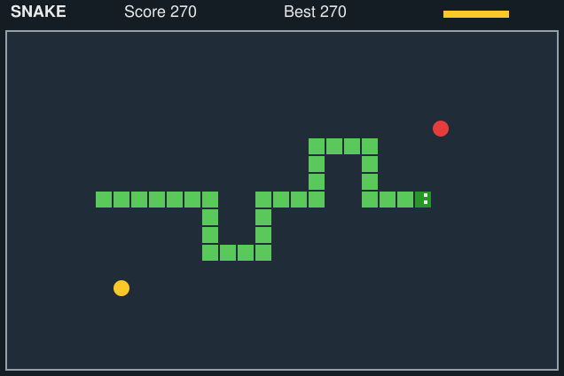
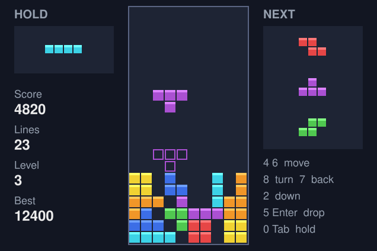
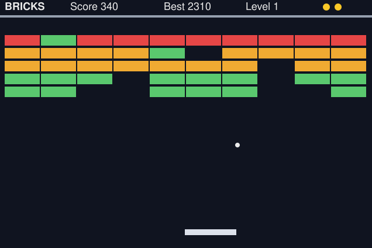
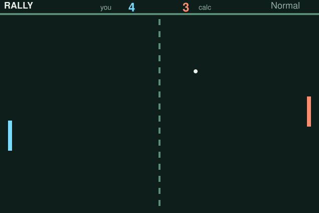
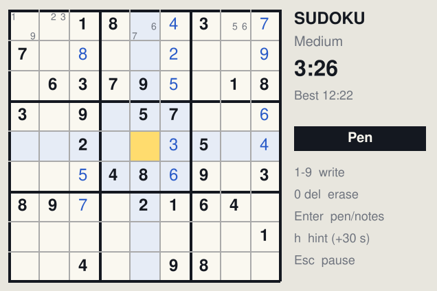
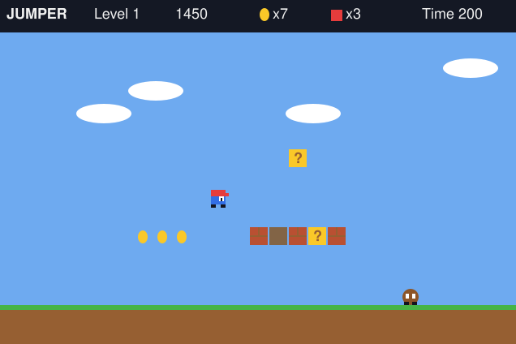

# Games for the TI-Nspire CX II (Lua)

Six small games written in TI-Nspire Lua, separate from nCAS. Each game is
one file in `games/lua/` and becomes one `.tns` document.

| Game | File | What it is |
|---|---|---|
| Snake | `lua/snake.lua` | Snake; walls or wrap-around. Tried on a CX II. |
| Blocks | `lua/blocks.lua` | Falling-block puzzle (Tetris-style) |
| Bricks | `lua/bricks.lua` | Bat and ball against a wall of bricks (Breakout-style) |
| Rally | `lua/rally.lua` | Bat and ball against the calculator (Pong-style) |
| Sudoku | `lua/sudoku.lua` | Sudoku with puzzles made on the calculator |
| Jumper | `lua/jumper.lua` | Side-scrolling platform game, 3 levels |

The names avoid other companies' trademarks; the games are written from
scratch, with their own art.

 
 
 

(Screens drawn on the computer from the test mock; the calculator's font differs.)

## Putting a game on the calculator

You need the TI-Nspire CX Student Software (6.2 has the Script Editor).

1. New document. **Insert ▸ Script Editor ▸ Insert Script**, give it a name
   (e.g. `blocks`).
2. Select everything in the editor, then paste the whole game file
   (e.g. `games/lua/blocks.lua`) over it.
3. **Set Script** (Ctrl+S in the editor), then close the editor. The game
   page shows the title screen.
4. Save the document (e.g. `Blocks.tns`) and send it to the calculator with the
   software's Content Explorer, as for nCAS.

Every file is under 20,000 characters, so it pastes in one go. The first
line of each file is `platform.apiLevel = '2.0'`; keep it as the first line.

All games: **Enter** starts from the title screen, **Esc** pauses and **Esc**
in the pause goes back to the title. The best score is kept in the document;
save the document to keep it.

## Snake

- **Arrows** or **8 4 6 2** steer. **Enter** also pauses.
- Title screen: **up/down** picks *Mode* or *Speed*, **left/right** changes it.
  *Walls*: hitting the edge ends the game. *Wrap*: the snake comes out on the
  other side.
- Food (red) is worth 10 and makes the snake one longer. Every 5th meal a gold
  bonus appears for 3.5 seconds (bar at the top right), worth 50.
- The snake gets faster every 5 meals. Best score per mode and speed
  (`snkbest1` … `snkbest6`).

## Blocks

| Key | Does |
|---|---|
| ◄ ► or 4 6 | move |
| ▲ or 8 (or 9, x) | turn right |
| 7 (or z) | turn left |
| ▼ or 2 | drop faster (1 point a row) |
| Enter or 5 | drop at once (2 points a row) |
| Tab or 0 | hold the piece (once per piece) |

- Title screen: **left/right** picks the starting level (1–10).
- The next three pieces are shown on the right; a faint outline shows where
  the piece will land. Pieces come in shuffled sets of all seven.
- 1/2/3/4 lines score 100/300/500/800 × level. Every 10 lines the level goes
  up and pieces fall faster. Pieces turn off walls and the floor where they can.
- Best score: `blkbest`.

## Bricks

- **◄ ►** or **4 6** push the bat. Each press speeds it up and it glides to
  a stop, so tap for small moves and hold (or tap quickly) to cross the screen.
- **Enter**, **8** or **▲** serves; **Enter** also pauses.
- Where the ball hits the bat sets its angle: the ends send it off sideways.
- Bricks need 1 (green), 2 (orange) or 3 (red) hits; grey ones never break.
  Clearing a wall starts the next of four layouts, each a little faster.
- 3 lives. Best score: `brkbest`.

## Rally

- **▲ ▼** or **8 2** push your bat (left, blue); it glides like the Bricks
  bat. First to 7 points wins. **Enter** also pauses.
- Title screen: **left/right** picks how good the calculator is. *Easy*
  misses about a third of the balls, *Normal* about one in eight, *Hard*
  about one in ten and also works out where the ball will bounce to.
- Hitting the ball near the end of your bat sends it off at a steeper angle,
  and the ball speeds up on every hit.
- Games won per level: `rlywins1` … `rlywins3`.

## Sudoku

| Key | Does |
|---|---|
| arrows | move (they wrap round) |
| 1–9 | write the digit (or, in notes mode, toggle a pencil note) |
| 0, del, clear | erase |
| Enter, Tab or n | switch between pen and notes |
| h | fill in the square for you (+30 s) |

- Title screen: **left/right** picks *Easy* (38 given), *Medium* (30) or
  *Hard* (25). Each puzzle is made on the calculator and has exactly one
  solution; a bar shows progress while it is made (a few seconds on Hard).
- A digit that clashes with another in its row, column or box turns red.
  Writing a digit removes it from the pencil notes around it.
- The squares that share a row, column or box with the cursor are shaded,
  and so are squares holding the same digit.
- Best (fastest) time per level, hints included: `sdkbest1` … `sdkbest3`.

## Jumper

| Key | Does |
|---|---|
| ◄ ► or 4 6 | walk |
| ▲, 8, 5 or Enter | jump |
| 7 / 9 | jump to the left / right |
| ▼ or 2 | stop |

- Run to the flag at the end of each of the 3 levels before the time runs
  out. Land on top of brown walkers to knock them out; purple spikies hurt
  from every side, so jump over them. Bump **?** blocks from below for coins
  and break bricks. 50 coins give an extra life. Falling into a pit, touching
  an enemy or running out of time costs a life; half-way through a level you
  restart from the middle.
- The calculator reports when a key is pressed but not when it is let go, so
  walking has two modes (title screen, **left/right**):
  - *Tap*: each press, or each repeat while a key is held, walks a short way.
  - *Keep going*: you keep walking until you press **▼** or the other way.
- A jump pressed just before landing, or just after walking off an edge,
  still counts.
- Best score: `jmpbest`.

## Testing on a computer

The tests run the games with a fake TI Lua API (`tests/lua/mock_ti.lua`) in
LuaJIT, which is Lua 5.1 like the calculator (`brew install luajit` or
`apt-get install luajit`):

```
luajit tests/lua/game_check.lua
luajit tests/lua/game_fuzz.lua 100
luajit tools/game_shots.lua
```

`game_check` checks the rules of every game (a Sudoku has one solution; a
bot that walks right and jumps at walls and pits finishes all Jumper levels;
the calculator in Rally can be beaten; and so on) and that every file pastes
in one go. `game_fuzz` presses random keys. `game_shots` redraws the pictures
in `games/img/`. The mock also flags anything drawn off the screen, font
sizes the handheld lacks and `drawString` without `"top"`.

## Not yet checked on a calculator

Snake has been tried on a CX II. Still to find out:

- How fast the arrow keys repeat while held (it decides which Jumper walk
  mode feels better, and how the Bricks and Rally bats glide).
- Whether 20 frames a second keeps up in Blocks and Jumper.
- How long Sudoku takes to make a Hard puzzle.
- Whether best scores are still there after saving and reopening a document.

If Lua does not work out for a game, the fallback is TI Python (`ti_draw`
with `ti_system.get_key`), as used by nCAS.
